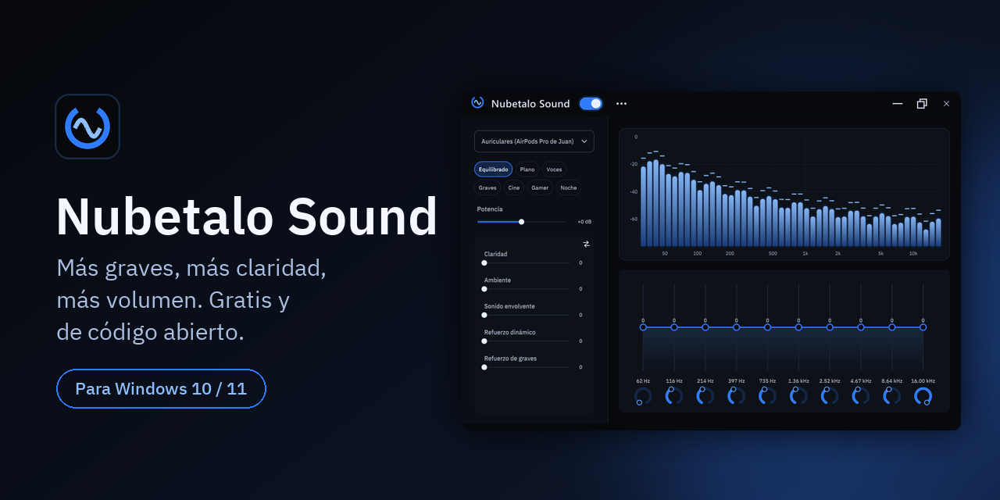
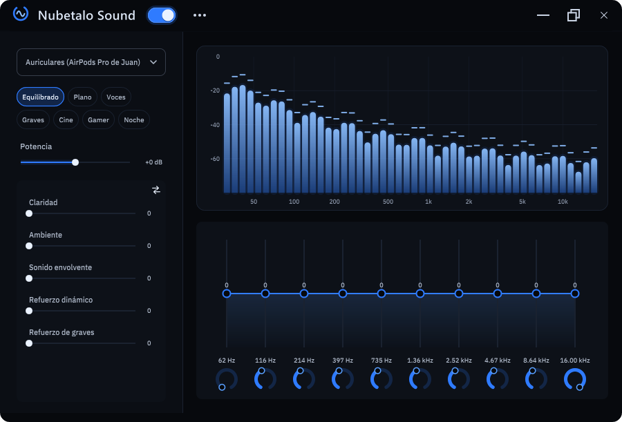
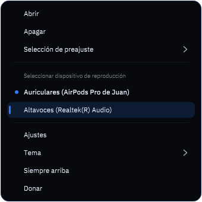
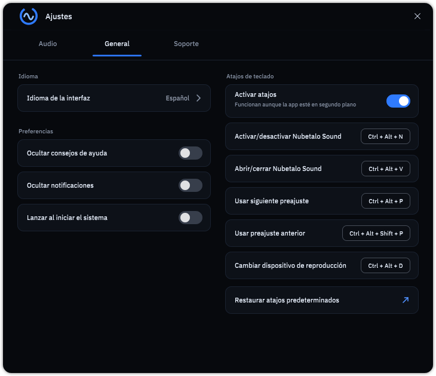
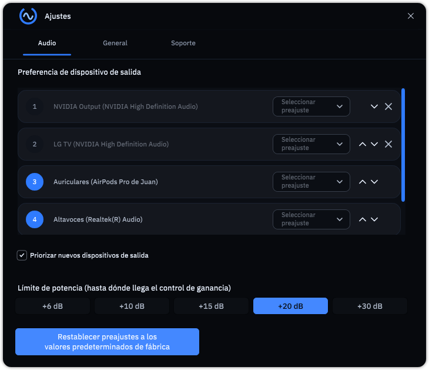

<p align="center"></p>

<h1 align="center">Nubetalo Sound</h1>
<p align="center"><b>Más graves, más claridad y más volumen en todo lo que suena en tu PC.</b><br>
Gratis · sin cuentas · sin anuncios · sin telemetría · código abierto</p>

<p align="center">
  <a href="../../releases/latest"><b>⬇ Descargar para Windows</b></a> ·
  <a href="#solución-de-problemas">Solución de problemas</a> ·
  <a href="#legal">Legal</a> ·
  <a href="https://www.paypal.com/donate/?business=juan.rodriguez.roman777%40gmail.com&currency_code=USD&item_name=Nubetalo+Sound">♥ Donar</a>
</p>

---

## ¿Por qué Nubetalo Sound?
Los altavoces del portátil suenan planos y los auriculares baratos no tienen graves. Nubetalo Sound procesa **todo el audio de Windows** (música, juegos, series, llamadas) antes de que llegue a tus altavoces o auriculares, sin tocar ningún programa.

| | |
|---|---|
| 🎚 **Ecualizador de 10 bandas** | Del grave profundo a los agudos, con espectro en tiempo real. |
| ✨ **5 efectos** | Claridad, ambiente, sonido envolvente, refuerzo dinámico y de graves. |
| 🔊 **Potencia de +6 a +30 dB** | Tú eliges hasta dónde llega el volumen. Útil cuando el audio original sale muy bajo. |
| 🎧 **Cambio automático de dispositivo** | Conectas tus auriculares y el sonido se pasa solo a ellos. Probado con AirPods Pro reales. |
| 💾 **Preajustes por dispositivo** | Un sonido para los auriculares y otro para los altavoces. Importa y exporta los tuyos. |
| ⌨ **Atajos de teclado** | `Ctrl+Alt+N` enciende o apaga, `Ctrl+Alt+P` cambia de preajuste. Puedes redefinirlos. |
| 🔒 **Privado** | Sin telemetría. Solo consulta en GitHub si hay una versión nueva (se puede desactivar). [Política de privacidad](PRIVACY.md). |
| 🌍 **Más de 20 idiomas** | Español, inglés, portugués, francés, alemán, japonés, coreano, chino, árabe y más. |

<p align="center">
  
  
</p>

## Instalación (1 minuto)
1. Descarga **`NubetaloSound-Setup-1.0.1.exe`** desde [Releases](../../releases/latest).
2. Ábrelo y sigue el asistente. Pide permisos de administrador porque instala un **dispositivo de audio virtual** (así Windows puede enviar el sonido a la app).
3. Abre Nubetalo Sound, enciende el interruptor y elige un preajuste.

> **Windows dice "Windows protegió su PC"**: es normal en programas nuevos sin firma de pago. Pulsa **Más información → Ejecutar de todos modos**. Puedes comprobar que el archivo es el mismo que publicamos con su huella SHA-256 (está en la página de la versión) y revisar todo el código aquí mismo.

Requisitos: Windows 10 u 11 de 64 bits.

## Uso rápido
- **Interruptor de la barra:** enciende o apaga el procesado.
- **Chips de preajuste:** Equilibrado, Plano, Voces, Graves, Cine, Gamer, Noche.
- **Menú `⋯`:** ajustes, guardar o renombrar preajustes, exportar e importar, siempre arriba, donar.
- **Bandeja del sistema:** clic derecho para cambiar de dispositivo y de preajuste sin abrir la ventana.
- **Línea de comandos:** `NubetaloSound.exe --power=1 --preset=Gamer` ([todas las opciones](app/docs/COMMAND_LINE_OPTIONS.md)).

<p align="center"> </p>

## Solución de problemas
**No se oye nada después de instalar.** Abre Nubetalo Sound y comprueba que el interruptor está encendido. En el menú de la bandeja elige tu dispositivo real (altavoces o auriculares). Si sigue sin sonar, en *Configuración de sonido de Windows* elige "FxSound Speakers" como salida y vuelve a abrir la app.

**Se oye distorsionado o muy fuerte.** Baja el control de *Potencia* o el límite de potencia en *Ajustes → Audio*. Un preajuste con muchos graves a +30 dB puede saturar altavoces pequeños.


**Los auriculares Bluetooth no se activan solos.** Mira que *Ajustes → Audio → Priorizar nuevos dispositivos de salida* esté marcado (viene activado).

**Quiero desinstalarlo.** *Configuración → Aplicaciones → Nubetalo Sound*. El desinstalador pregunta si quieres quitar también el dispositivo virtual.

**Algo falla.** Escribe a **juanrrrhlm@gmail.com** con el asunto `[Nubetalo Sound Soporte]` (o desde *Ajustes → Soporte → Reportar un problema*, que añade la versión de Windows sin datos personales) o abre un *issue* en este repositorio.

## Seguridad y privacidad
- No hay telemetría ni cuentas. La única conexión es la consulta de versión nueva en GitHub (sin enviar datos tuyos, se puede desactivar). Lo demás que sale del equipo es lo que tú envíes a soporte.
- Los presets importados se validan (tamaño y nombre) para que un archivo malicioso no pueda escribir fuera de su carpeta. Hay pruebas en `tools/dsp_test`.
- El ejecutable usa DEP, ASLR de alta entropía y Control Flow Guard.
- Informes de seguridad: [SECURITY.md](SECURITY.md).

## Legal
Nubetalo Sound es **software libre bajo la licencia GNU AGPL v3**.
- Puedes usarlo, copiarlo y modificarlo. Si distribuyes una versión modificada, o la ofreces como servicio en red, debes publicar tu código bajo la misma licencia.
- Está basado en [FxSound](https://github.com/fxsound2/fxsound-app) (© FxSound LLC, AGPL v3). **Nubetalo Sound no está afiliado ni respaldado por FxSound LLC**; "FxSound" es marca de sus titulares y solo se menciona para dar crédito y explicar el dispositivo de audio virtual que se reutiliza.
- Incluye [JUCE](https://juce.com) (AGPL v3) y la tipografía [IBM Plex](https://github.com/IBM/plex) (SIL OFL).
- Todos los créditos y avisos están en [NOTICE.txt](NOTICE.txt); el texto completo de la licencia, en [LICENSE.txt](LICENSE.txt).
- Se ofrece **sin garantía** de ningún tipo. Usa potencias altas con cuidado: pueden dañar altavoces y el oído.

## Compilar desde el código
Requisitos: Visual Studio 2022 Build Tools (C++), Windows SDK y [JUCE 6.1.6](https://github.com/juce-framework/JUCE/releases/tag/6.1.6) descomprimido en `JUCE\` (no se incluye en el repositorio).
```
tools\resave.sh            # genera el proyecto con Projucer
tools\build_release.sh     # versión de distribución
tools\make_installer.ps1   # instalador (necesita Inno Setup 6)
```

## Apoya el proyecto
Si te gusta, comparte la app o [dona un café](https://www.paypal.com/donate/?business=juan.rodriguez.roman777%40gmail.com&currency_code=USD&item_name=Nubetalo+Sound). Lo recaudado se usará, por este orden, en la firma de código (para que Windows deje de avisar).
